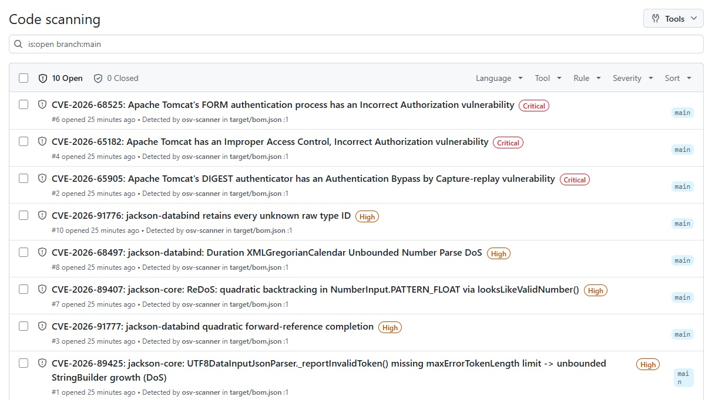
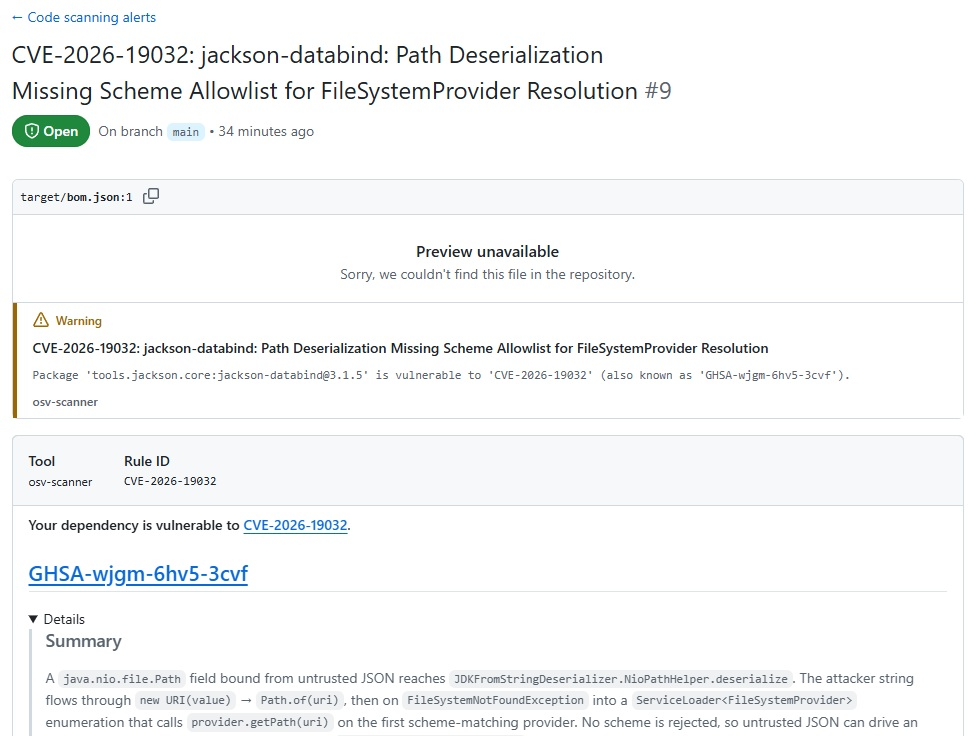
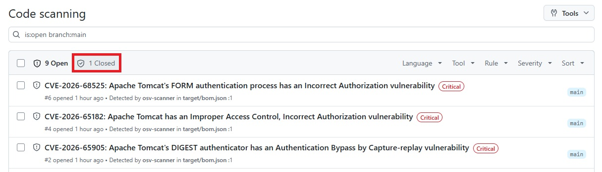

Completed devops-demo for [Lesson 4.14: DevSecOps Practicals - OSV-Scanner and OWASP ZAP](https://github.com/su-ntu-sctp/ai-4.14-devsecops-practicals/blob/main/lesson.md)

## Part 2 - Add OSV-Scanner with GitHub Actions

### Step 3 - Choose One Finding

### Step 4: Ignore It - with a Reason and an Expiry

